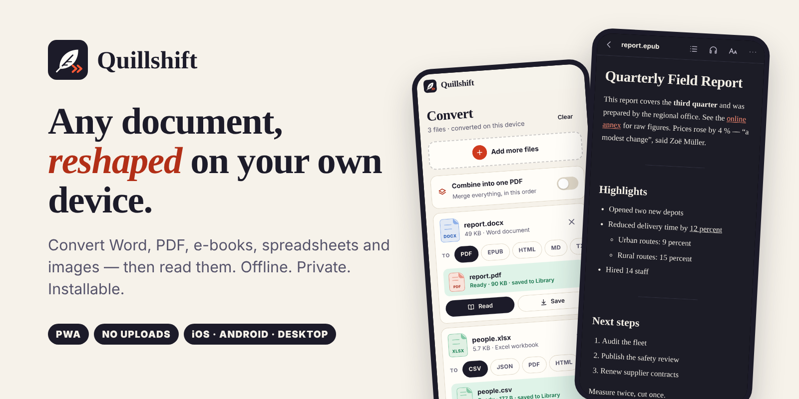
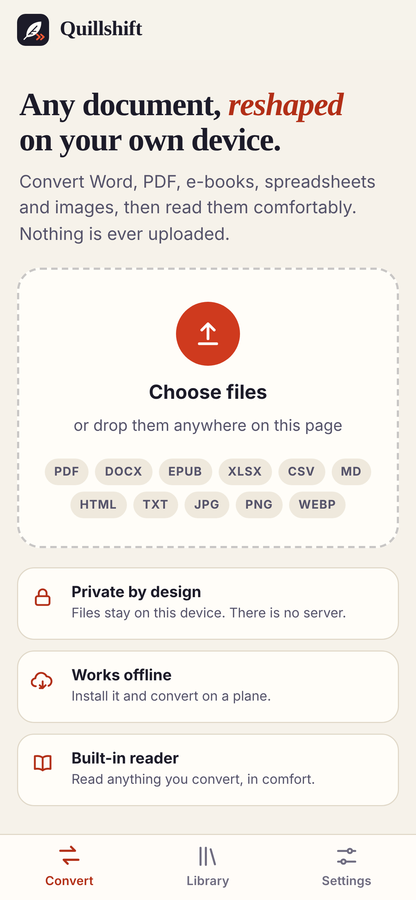
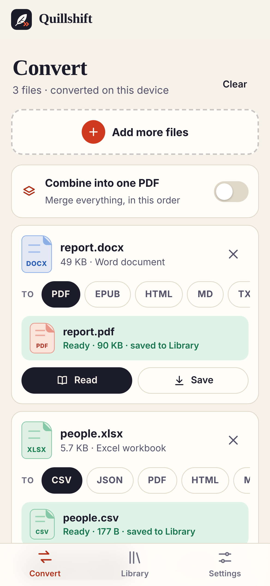
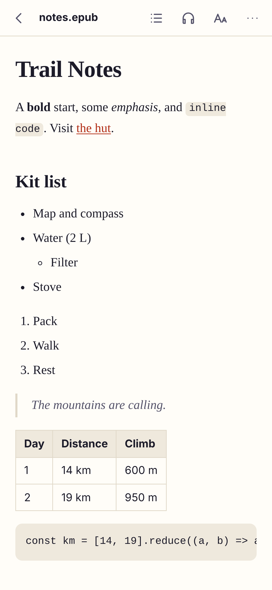
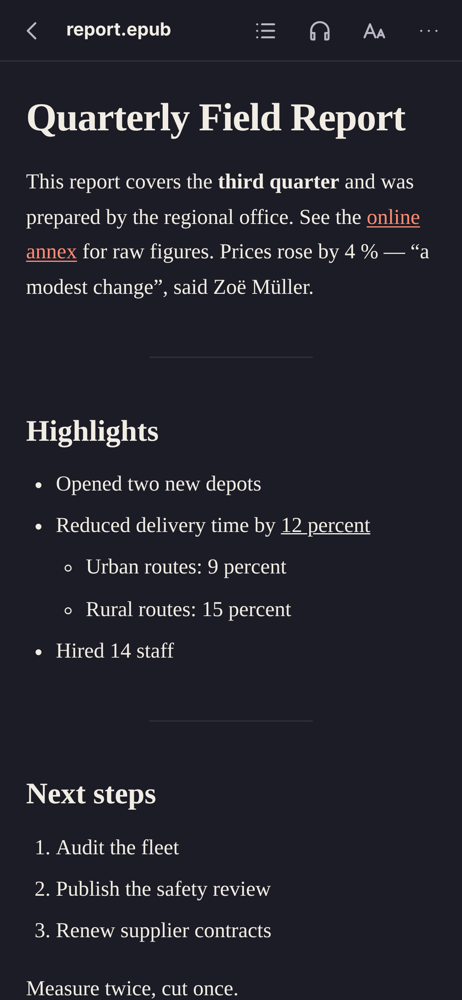
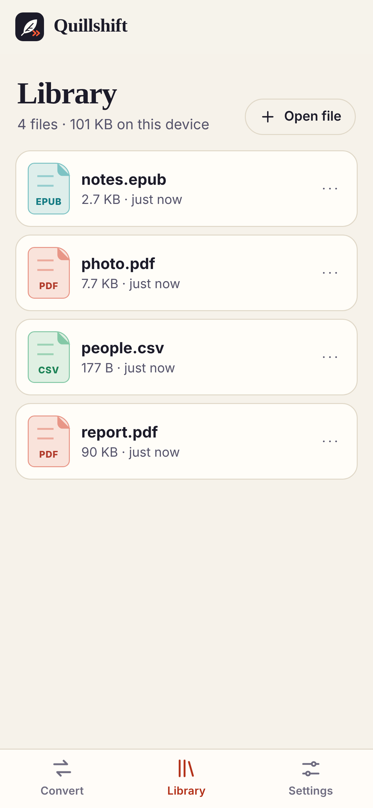

<p align="center">
  
</p>

<h1 align="center">Quillshift</h1>

<p align="center">
  <b>Convert documents and read them — entirely on your own device.</b><br>
  An installable, offline-first PWA for iPhone, Android and desktop. No uploads, no account, no server.
</p>

<p align="center">
  
  
  
  
  
  
</p>

<p align="center">
  
  
  
  
</p>

---

## Why Quillshift

Most "free online converters" upload your contract, payslip or manuscript to someone else's computer. Quillshift does the work in your browser instead:

- **Private by construction.** A Content Security Policy forbids the app from contacting any other origin. The test suite fails if a single off-origin request is made.
- **Works offline.** Install it, switch on flight mode, keep converting.
- **Light on storage.** The app itself is about 67 KB gzipped. Conversion engines are fetched only the first time you need them, and you can see and remove them in Settings.
- **A reader, not just a converter.** Everything you convert opens in a comfortable reader with themes, type controls, a table of contents, read-aloud, and remembered position.

## What it converts

| From | To |
| --- | --- |
| **Word** `.docx`, **OpenDocument** `.odt` | PDF · DOCX · EPUB · HTML · Markdown · TXT |
| **EPUB** e-books | PDF · DOCX · HTML · Markdown · TXT |
| **Markdown**, **HTML**, **plain text** | PDF · DOCX · EPUB · HTML · Markdown · TXT |
| **PDF** | DOCX · TXT · EPUB · HTML · Markdown · JPG / PNG page images · extract pages |
| **Excel** `.xlsx`, **CSV / TSV**, **JSON** | XLSX · CSV · JSON · PDF · HTML · Markdown |
| **Images** PNG · JPG · WEBP · GIF · BMP · SVG (AVIF / HEIC where the browser can decode them) | PDF · JPG · PNG · WEBP |
| **Any mix of the above** | **One combined PDF**, in the order you choose |

Options include page size, orientation, margins, page numbers, image quality, resize and page-image sharpness.

### Honest limits

- **PDF → Word/EPUB/text rebuilds the text**, headings and bullet lists from the PDF's geometry. It does not reproduce the original page layout, and scanned PDFs (pictures of pages) have no text to extract — there is no OCR.
- **PDF output comes in two styles.** *Text* gives small, selectable, searchable PDFs using an embedded Latin/Greek/Cyrillic font. Documents in other scripts (Chinese, Arabic, Hindi, emoji…) automatically use *Snapshot*, which draws each page exactly as the browser renders it — faithful, but the text is not selectable.
- Legacy binary formats (`.doc`, `.xls`, `.ppt`) and DRM-protected e-books are not supported.
- WEBP output and HEIC/AVIF input depend on the browser.

## Install it

Quillshift is a Progressive Web App: there is nothing to download from a store.

**iPhone / iPad** — open the site in **Safari** → tap **Share** → **Add to Home Screen** → **Add**.

**Android** — open the site in **Chrome** → tap **Install** in the top bar (or **⋮ → Install app**). Once installed, Quillshift also appears in Android's share sheet, so you can send a file to it from any app.

**Desktop** (Chrome, Edge) — click the install icon in the address bar. You can then right-click a file and choose *Open with → Quillshift*.

## The reader

<p>
  
</p>

- Reflowable view for Word, EPUB, Markdown, HTML and text — and a **"read as text" mode for PDFs**, which makes them comfortable on a phone
- Paper, Sepia and Night themes; serif / sans / mono; text size, line spacing, column width, justification
- Table of contents built from headings
- **Listen**: read aloud with your device's voices, with speed control and paragraph highlighting
- PDF page view with lazy rendering and zoom; spreadsheet grid with sticky headers; image and archive viewers
- Remembers how far you read in every file

<br clear="right">

## Run it yourself

It is a static site with no build step.

```bash
git clone https://github.com/<you>/quillshift.git
cd quillshift
npm start            # http://localhost:4173
```

Any static host works (GitHub Pages, Netlify, Cloudflare Pages, S3…). It must be served over **HTTPS** for installation and offline support. All paths are relative, so it runs from a sub-folder such as `https://<you>.github.io/quillshift/`.

### Deploy to GitHub Pages

The included workflow (`.github/workflows/pages.yml`) runs the tests and publishes on every push to `main`. Enable it once under **Settings → Pages → Build and deployment → Source: GitHub Actions**.

### Develop

```bash
npm install          # only needed for tests and for re-vendoring engines
npm install playwright && npx playwright install chromium
npm test             # 22 end-to-end checks in headless Chromium
npm run stamp        # after editing css/, js/, icons/ or index.html
```

`npm run stamp` rewrites `precache-manifest.js` with a content hash. The service worker installs a new cache only when that hash changes, then offers users an **Update** button — so releases are atomic and never mix old and new files. `npm test` fails if you forget.

## How it works

```
index.html ─ css/app.css ─ js/app.js            app shell (precached, ~67 KB gzipped)
                              │
        ┌─────────────────────┼─────────────────────┐
   views/convert         views/library          views/reader
        │                     │                     │
        └────────── js/convert/index.js ────────────┘      the pipeline
                              │
   doc-in ─► sanitised HTML ─► pdf-out · docx-out · epub-out · doc-out
   sheet  ─► workbook       ─► xlsx · csv · json · html · md
   image  ─► canvas         ─► jpg · png · webp · pdf
   pdf-in ─► page images / reflowed HTML        pdf-tools ─► merge · extract
                              │
                    vendor/  (lazy, cached on first use)
```

- **One intermediate form.** Every text document becomes sanitised HTML (DOMPurify), which the reader displays and every exporter starts from. That is why any text format converts to any other.
- **Hand-written writers where a library would be heavy.** DOCX, EPUB and XLSX are produced by small purpose-built modules on top of a 30 KB zip library, rather than ~1.5 MB of general-purpose packages. The XLSX reader is also custom.
- **Storage.** Converted files live in IndexedDB; preferences in `localStorage`. Nothing is synced anywhere. Optional auto-tidy removes old files after 7 or 30 days.
- **Service worker.** A versioned shell cache, a lazily filled engine cache, and a share-target inbox for files sent from other apps.

### Third-party engines

Loaded on demand from `vendor/` (unmodified npm builds — see [`vendor/THIRD-PARTY.md`](vendor/THIRD-PARTY.md)):
[pdf.js](https://github.com/mozilla/pdf.js) · [pdfmake](https://github.com/bpampuch/pdfmake) · [pdf-lib](https://github.com/Hopding/pdf-lib) · [mammoth](https://github.com/mwilliamson/mammoth.js) · [html2canvas](https://github.com/niklasvh/html2canvas) · [html-to-pdfmake](https://github.com/Aymkdn/html-to-pdfmake) · [fflate](https://github.com/101arrowz/fflate) · [marked](https://github.com/markedjs/marked) · [Turndown](https://github.com/mixmark-io/turndown) · [DOMPurify](https://github.com/cure53/DOMPurify)

## Browser support

Current Safari (iOS 16.4+), Chrome, Edge and Firefox. Installation prompts, the share target and "Open with" are Chromium features; iOS installs through *Add to Home Screen*.

## Licence

[MIT](LICENSE). Third-party engines keep their own licences.
